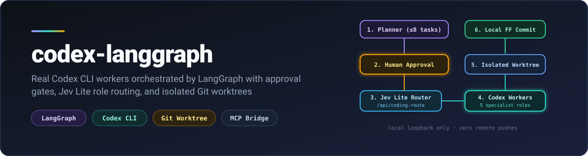
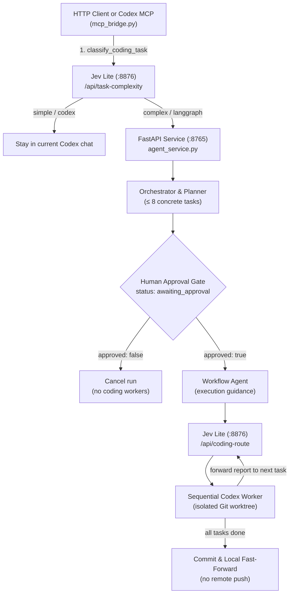

<div align="center">



# Codex Agents Orchestrated by LangGraph

**A local FastAPI + LangGraph service that runs real Codex CLI processes behind a human approval gate, Jev Lite role routing, and isolated Git worktrees.**


[Architecture](#-architecture) · [Specialist Roles](#-specialist-roles) · [Quick Start](#-quick-start) · [HTTP API](#-http-api) · [MCP Bridge](#-mcp-integration) · [Configuration](#-configuration) · [Limits & Testing](#-limits--testing)

</div>

---

This local API runs **real Codex CLI processes** inside LangGraph nodes: an orchestrator scopes and reports, a planner splits a change into up to eight small tasks, planning pauses for explicit human approval, a workflow agent sets execution guidance, [Jev Lite](https://github.com/aayushhzz/jev-lite) selects a bounded specialist role for each task, and a fresh Codex worker executes each task sequentially inside a detached, isolated Git worktree. Approved changes are committed and fast-forwarded into the original local repository when the run finishes. Nothing is pushed to a remote.

---

## Architecture



---

## Specialist Roles

Before every coding worker, the graph calls Jev Lite's `/api/coding-route` endpoint and fails the run if routing is unavailable or invalid (it never silently guesses a role). Each worker receives the planner's concrete task, a fixed role-specific focus, and prior worker reports via LangGraph state.

| Role | Access Mode | Default Model Env | Per-Role Override Env |
| --- | --- | --- | --- |
| `implementer` | Write in isolated worktree | `CODEX_MODEL_WORKER` | `CODEX_MODEL_IMPLEMENTER` |
| `debugger` | Write in isolated worktree | `CODEX_MODEL_WORKER` | `CODEX_MODEL_DEBUGGER` |
| `test_writer` | Write in isolated worktree | `CODEX_MODEL_WORKER` | `CODEX_MODEL_TEST_WRITER` |
| `refactorer` | Write in isolated worktree | `CODEX_MODEL_WORKER` | `CODEX_MODEL_REFACTORER` |
| `researcher` | Read-only sandbox | `CODEX_MODEL_WORKER` | `CODEX_MODEL_RESEARCHER` |

---

## Quick Start

### 1. Start Jev Lite

Start [Jev Lite](https://github.com/aayushhzz/jev-lite) first on `http://127.0.0.1:8876` (`python3 server.py` in its directory). Set `JEV_LITE_URL` if running on another **HTTP loopback origin**.

### 2. Install & Run the Service

```sh
python3 -m venv .venv
.venv/bin/pip install -r requirements.txt

export OPENAI_API_KEY="sk-..."
export CODEX_BIN=/absolute/path/to/codex   # omit if codex is on PATH
export CODEX_MODEL_ORCHESTRATOR=gpt-6-sol
export CODEX_MODEL_PLANNER=gpt-6-sol
export CODEX_MODEL_WORKFLOW=gpt-6-sol
export CODEX_MODEL_WORKER=gpt-6-luna

.venv/bin/uvicorn agent_service:app --host 127.0.0.1 --port 8765
```

Restart the service after updating its source so the running process loads changes.

---

## HTTP API

```sh
# 1. Start a planning run against a clean local Git repository
curl -sS http://127.0.0.1:8765/tasks \
  -H 'Content-Type: application/json' \
  -d '{"repo":"/absolute/path/to/git/repo","request":"Implement the requested change"}'

# 2. Poll until status is "awaiting_approval" and inspect the returned plan
curl -sS http://127.0.0.1:8765/tasks/TASK_ID

# 3. Approve (or set approved:false to cancel without running any coding worker)
curl -sS http://127.0.0.1:8765/tasks/TASK_ID/approval \
  -H 'Content-Type: application/json' \
  -d '{"approved":true}'
```

The approval endpoint returns immediately while workers execute in the background. A completed record contains `status`, graph events (including each selected agent and assignment), the `worktree` path, the final report, and the local Git `commit` (`null` when no files changed).

---

## MCP Integration

[`mcp_bridge.py`](mcp_bridge.py) exposes the loopback API as a `stdio` FastMCP server (`jev-codex-langgraph`) for Codex:

| Tool | Endpoint | Purpose |
| --- | --- | --- |
| `classify_coding_task(task, context)` | `Jev Lite /api/task-complexity` | Returns `simple`/`codex` (stay in chat) or `complex`/`langgraph` (escalate) |
| `start_routed_coding_run(repo, request)` | `POST /tasks` | Starts an isolated LangGraph run and returns its 32-char task ID |
| `get_routed_coding_run(task_id)` | `GET /tasks/{task_id}` | Reads status, planned tasks, role decisions, and final result |
| `approve_routed_coding_run(task_id, approved)` | `POST /tasks/{task_id}/approval` | Resumes or cancels a planned run after user review |

If Jev Lite is unavailable, the MCP tools fail rather than guessing a route. Restart Codex after registering `jev_codex_langgraph` if the tools are not immediately visible.

---

## Configuration

| Variable | Default | Description |
| --- | --- | --- |
| `OPENAI_API_KEY` | *(required)* | Provided to the service environment; never place keys in requests or repo files |
| `CODEX_BIN` | `codex` on `PATH` | Absolute path to the Codex CLI binary |
| `CODEX_AGENT_HOME` | `./codex-home` | Minimal Codex config directory (isolates workers from personal hooks/MCP servers) |
| `JEV_LITE_URL` | `http://127.0.0.1:8876` | Loopback HTTP origin for Jev Lite routing |
| `CODEX_MODEL_ORCHESTRATOR` / `PLANNER` / `WORKFLOW` / `WORKER` | — | Model selection for graph stages and default workers |
| `CODEX_MODEL_<ROLE>` | `CODEX_MODEL_WORKER` | Optional per-role model override (`IMPLEMENTER`, `DEBUGGER`, `TEST_WRITER`, `REFACTORER`, `RESEARCHER`) |
| `CODEX_TASK_ROOT` | System temp dir | Root directory for isolated Git worktrees |
| `CODEX_TIMEOUT_SECONDS` | `900` | Per-agent execution timeout in seconds |

The included [`codex-home/config.toml`](codex-home/config.toml) is a minimal Codex configuration that stores no key; uncomment its provider block to use your own gateway.

---

## Repository Layout

| Path | Description |
| --- | --- |
| [`agent_service.py`](agent_service.py) | FastAPI server, LangGraph state machine, Codex CLI runner, Git worktree lifecycle |
| [`mcp_bridge.py`](mcp_bridge.py) | FastMCP `stdio` bridge exposing the 4 routed coding tools to Codex |
| [`codex-home/`](codex-home/) | Minimal isolated Codex CLI configuration (`config.toml`) |
| [`requirements.txt`](requirements.txt) | Pinned runtime dependencies (`langgraph`, `fastapi`, `uvicorn`, `mcp`) |
| [`tests/test_agent_service.py`](tests/test_agent_service.py) | Unit tests for the orchestration service |

---

## Limits & Testing

- **Local only:** This API has no authentication; bind strictly to loopback (`127.0.0.1`).
- **Clean Git repo required:** Worktrees require a clean repository with at least one commit; uncommitted changes are not copied. If the repo moves while workers run, publication fails safely and the worktree remains on disk for manual review.
- **In-memory state:** Task state and checkpoints live in memory and reset on server restart (worktrees remain on disk).
- **Bounded sequential execution:** Plans are capped at 8 tasks; workers run sequentially as fresh, low-reasoning Codex processes to avoid conflicting edits.
- **Routing caveat:** Jev Lite uses a local conventional language model; its routing judgment is not guaranteed calibrated.

Run the test suite (install `pytest` separately):

```sh
python3 -m pytest tests
```
